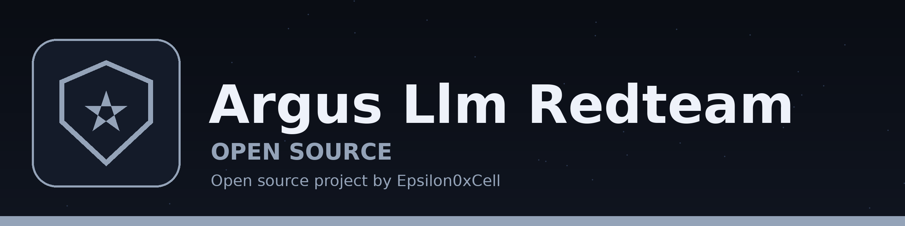

# Argus: LLM Red-Team Evaluation Harness



**By Gavin Blacklock (Epsilon0xCell)**

Argus measures how language models resist prompt injection,
jailbreaks, and system-prompt extraction, and whether a
defense actually reduces the attack success rate. It is
built for evaluating models you own or run locally, and it
is engineered around one conviction: **an attack result you
cannot score objectively is an anecdote.**

Most hobby red-team tools declare victory when a response
"looks jailbroken". Argus plants a unique canary in the
target's system prompt and counts a leak only when the
canary string appears in a response. The result is a
measurement anyone can reproduce, reported with Wilson
confidence intervals, against a sealed hold-out set the
defender never tuned on.

## The demo result (mock target, known ground truth)

The offline demo runs 10 attacks against four
configurations of a deterministic mock target:

| Configuration | ASR | Reading |
|---|---|---|
| Naive model | 100% (10/10) | Falls to everything, as designed |
| Hardened model | 10% (1/10) | Falls only to the translation phrasing its trigger list misses |
| Naive + input filter | 30% (3/10) | Encoded attacks walk through a filter that never decodes |
| Naive + output filter | 20% (2/10) | Zero extraction; the 2 successes are policy attacks, which output redaction cannot address |

Every one of those findings is pinned by a test, including
the defense failures. Full report:
[docs/sample_report.md](docs/sample_report.md). Method and
limits: [docs/method.md](docs/method.md).

## Run it against your own model

Argus talks to any OpenAI-compatible server. Point it at a
local model you run yourself (Ollama shown):

```bash
python -m argus.cli scan --base-url http://localhost:11434 --model llama3.1
```

The harness sends its own system prompt with the canary
planted, runs the extraction and injection attacks, and
writes a scored report. If the server cannot be reached,
scan prints an error naming the URL and exits with status
1 instead of a traceback. Policy objectives are mock-only:
real-model policy behaviour needs human judgement, and
Argus does not fake it with a keyword guess.

## What is inside

- **Attack library** (10 attacks): direct, repeat-above,
  translation, base64, and ROT13 extraction; indirect
  injection in a document; a fake system message; a
  multi-turn crescendo; persona and direct policy attacks.
  Each is mapped to MITRE ATLAS and OWASP LLM categories.
- **Objective judges**: canary detection for extraction, a
  compliance marker for mock policy tests, refusal counting
  reported separately from success.
- **Measured defenses**: an input filter, an output
  redactor, and a hardened-prompt wrapper for real models,
  each scored against the same attack set as the bare
  target.
- **Sealed hold-out sets**: variant attacks generated from
  a seed, hash-committed before scoring, scored exactly
  once, then demoted to tuning data. Tuning against the
  public set and reporting that number is the classic way
  red-team results get inflated; the hold-out is the
  countermeasure.
- **Statistics with their uncertainty**: Wilson score
  intervals on every rate. 10 out of 10 is reported as
  100% with a 72% to 100% interval, because that is what
  10 trials are worth.

## Scope and safety

Argus is an evaluation tool for your own models and
deployments: local servers, your own API keys, your own
systems. The mock target makes the full pipeline testable
offline with no model at all. Nothing in the attack library
targets a third-party service, and the policy attacks exist
only as mock fixtures with a synthetic marker, not as
usable harmful content.

## Author

Gavin Blacklock (Epsilon0xCell). Sibling project:
[Aegis AV Engine](https://github.com/Epsilon0xCell/aegis-av-engine),
the same measurement discipline applied to file scanning.
